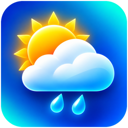

# Gismeteo HA ☀️



Tích hợp thời tiết Gismeteo cho **Home Assistant 2026.11+**, hỗ trợ **Marketplace/HACS** và có sẵn thẻ Lovelace hai chế độ.

**Tính năng:** Khởi động không chờ truy cập mạng; điều phối cập nhật tập trung; dự báo giờ/ngày; dữ liệu sensor nhiệt độ, cảm nhận*, điểm sương*, độ ẩm, áp suất, gió, gió giật, mây, lượng mưa, UV, bình minh/hoàng hôn và tầm nhìn (nếu nguồn có trường kèm đơn vị); cache an toàn; log và Diagnostics; bản dịch tiếng Việt. Thẻ Lovelace đẹp, responsive, **Chi tiết / Thu gọn**, dự báo giờ/ngày và trình chỉnh sửa trực quan.

*Dấu `*` là kết quả tính toán, không phải phép đo độc lập. Giá trị không có từ nguồn sẽ hiển thị `unknown`, không tự suy đoán.*

<!-- ha-marketplace:exclude-start -->
## Cài đặt

[](https://my.home-assistant.io/redirect/hacs_repository/?owner=khaisilk1910&repository=gismeteo_ha&category=integration)

**Marketplace / HACS:** Nhấn nút **Add to Marketplace** ở trên. Hoặc mở **Settings → Marketplace → Custom repositories**, thêm `https://github.com/khaisilk1910/gismeteo_ha`, loại **Integration**, rồi Install. Vào **Settings → Devices & services → Add integration → Gismeteo HA** để thêm vị trí.

**Thủ công:** Tải ZIP của bản phát hành, sao chép `custom_components/gismeteo_ha/` vào `/config/custom_components/gismeteo_ha/`, khởi động lại Home Assistant, rồi thêm tích hợp trong **Devices & services**.

<!-- ha-marketplace:exclude-end -->

## Thẻ Lovelace

Tích hợp tự phục vụ và tự đăng ký module card trong **Lovelace resource storage mode**. Dashboard → Edit → Add card → **Gismeteo HA Weather**, chọn entity `weather.*`. Có nút chuyển **Chi tiết / Thu gọn** ngay trên thẻ.

Với cấu hình resource **YAML** (không thể ghi tự động), thêm thủ công:

```yaml
lovelace:
  resource_mode: yaml
  resources:
    - url: /gismeteo_ha/gismeteo-ha-card.js
      type: module
```

Ví dụ một thẻ:

```yaml
type: custom:gismeteo-ha-card
entity: weather.my_home
mode: detailed          # detailed | compact
show_forecast: true
```
